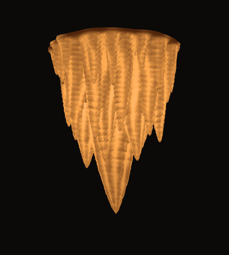
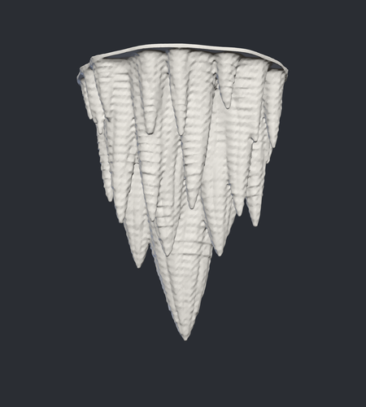

# Stalactite chandelier

A 3D-printable lamp shade: a cluster of 50-odd stalactites fused into one hollow
shell, lit from inside by a single bulb. Designed for white (translucent) filament.

 

## Files

| File | What it is |
| --- | --- |
| `stalactite_chandelier.stl` | Print file, millimetres, already oriented for printing (tips up, flat rim on the bed) |
| `index.html` + `preview.ply` | Interactive 3D viewer with a simulated lamp-on glow |
| `generate.py` | The script that sculpts everything; edit the numbers and re-run to change the design |

## The design

- **Size:** 186 mm across, 230 mm tall (first pass; scale in the slicer or with `--scale`).
- **Composition:** one large central stalactite, a ring of six long companions,
  a middle ring of ten, a fringe of fifteen short ones, and about twenty thin
  soda straws scattered through.
- **Surface:** vertical drapery flutes with sharp creases, irregular drip rings
  that fade in and out, and a fine calcite texture.
- **Shell:** hollow throughout, 1.2 mm in the creases to roughly 4 mm on the
  lobes. The thickness follows the surface detail, so creases glow brightest and
  the rings read as light and dark bands when the lamp is on.
- **Top:** open, with a flat 3 mm rim, ready for a mounting plate or socket
  holder to be designed later.
- **Bulb space:** the opening is about 150 mm wide at the rim and stays wider
  than 60 mm down to about 105 mm deep.

## Printing

- Print as oriented, no supports. Under 0.5% of the surface overhangs past 45°.
- About 211 cm³ of plastic (roughly 260 g of PLA).
- Use an LED bulb only. PLA softens at around 55–60 °C.
- The STL has one edge where two surfaces touch; slicers repair this on import.

## Regenerating

```bash
pip install numpy scipy scikit-image scikit-fmm fast-simplification trimesh
```

```bash
python3 generate.py --voxel 0.5 --seed 7
```

A different `--seed` gives a different cluster. `--voxel 1.0` is a fast draft
(20 s instead of 3 min). Takes about 3 GB of RAM at the default resolution.
